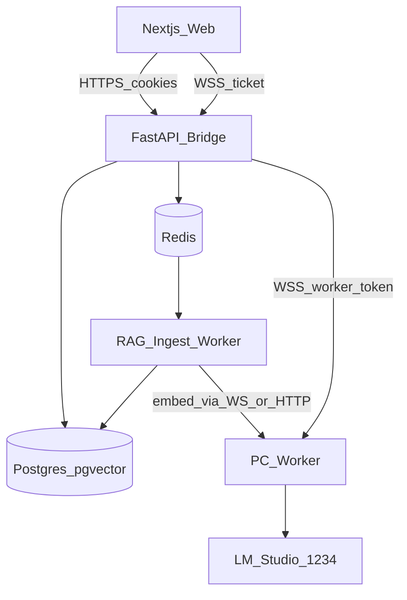

# Architecture

**English** · [فارسی](fa/architecture.md)

## Goals

AI Workspace splits **control plane** (Bridge + DB + Redis + Web) from **inference plane** (PC Worker + LM Studio). Browsers never talk to LM Studio directly.

## Component diagram

## Modules

| Module | Path | Responsibility |
|--------|------|----------------|
| Bridge API | `backend/app/` | Auth, RBAC, chats, knowledge metadata, WS hub, admin |
| RAG worker | `backend/app/workers/rag.py` | ARQ jobs: parse → chunk → embed → store |
| Web | `web/app/` | Login, chat, knowledge, admin (RTL) |
| PC Worker | `pc_client/main.py` | Chat stream + embeddings against LM Studio |
| Schema | `backend/alembic/` | Postgres migrations including pgvector |

## Trust boundaries

1. **Browser ↔ Bridge** — HTTPS + httpOnly JWT cookies; WS uses short-lived tickets.
2. **Bridge ↔ Worker** — shared `WORKER_TOKEN` over WSS; optional relay `ENCRYPTION_KEY` never injected into HTML.
3. **Worker ↔ LM Studio** — localhost (or LAN) only; not exposed to the public internet by design.
4. **Data isolation** — chats and RAG chunks are scoped by `user_id` (plus optional shared knowledge flags).

## Runtime ports (local defaults)

| Service | Port |
|---------|------|
| Bridge (host) | **8010** (`BRIDGE_HOST_PORT`; container internal `8000`) |
| Next.js | 3000 |
| Postgres | 55432 → 5432 |
| Redis | 26379 → 6379 |
| LM Studio | 1234 |

## Failure domains

- If **Worker** disconnects, `/api/ready` reports degraded; chats/embeds fail closed.
- If **Redis** is down, rate-limit and ARQ ingest stop; prefer fail loud over silent queue loss.
- If **Postgres** is down, Bridge is not ready; no dual-write to SQLite in product mode.

See also: [setup.md](setup.md), [security.md](security.md), [rag.md](rag.md).
