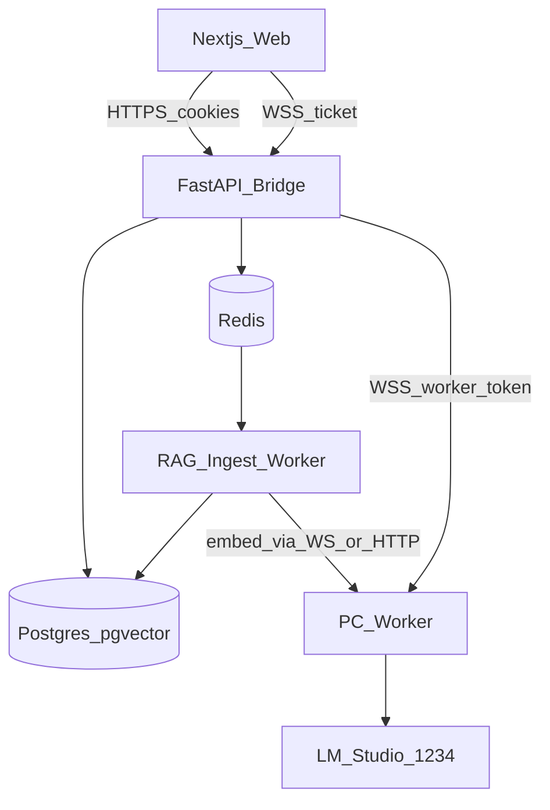

# معماری

[English](../architecture.md) · **فارسی**

## اهداف

AI Workspace **صفحهٔ کنترل** (Bridge + DB + Redis + Web) را از **صفحهٔ استنتاج** (PC Worker + LM Studio) جدا می‌کند. مرورگر هرگز مستقیماً با LM Studio حرف نمی‌زند.

## دیاگرام اجزا

## ماژول‌ها

| ماژول | مسیر | مسئولیت |
|-------|------|---------|
| Bridge API | `backend/app/` | Auth، RBAC، چت، دانش، هاب WS، ادمین |
| RAG worker | `backend/app/workers/rag.py` | شغل ARQ: parse → chunk → embed → store |
| وب | `web/app/` | ورود، چت، دانش، ادمین (RTL) |
| PC Worker | `pc_client/main.py` | استریم چت + embeddings روی LM Studio |
| اسکیما | `backend/alembic/` | مهاجرت Postgres شامل pgvector |

## مرزهای اعتماد

1. **مرورگر ↔ Bridge** — HTTPS + کوکی JWT httpOnly؛ WS با بلیت کوتاه‌عمر.
2. **Bridge ↔ Worker** — `WORKER_TOKEN` مشترک روی WSS؛ `ENCRYPTION_KEY` هرگز به HTML تزریق نمی‌شود.
3. **Worker ↔ LM Studio** — فقط localhost/LAN؛ به‌طراحی به اینترنت عمومی باز نیست.
4. **ایزوله داده** — چت و chunkهای RAG با `user_id` محدود می‌شوند.

## پورت‌های پیش‌فرض محلی

| سرویس | پورت |
|-------|------|
| Bridge (میزبان) | **۸۰۱۰** |
| Next.js | ۳۰۰۰ |
| Postgres | ۵۵۴۳۲ → ۵۴۳۲ |
| Redis | ۲۶۳۷۹ → ۶۳۷۹ |
| LM Studio | ۱۲۳۴ |

همچنین: [setup.md](setup.md)، [security.md](security.md)، [rag.md](rag.md).
