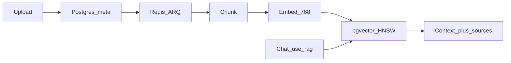

# RAG

[English](../rag.md) · **فارسی**

خط لوله:

1. آپلود PDF/TXT/MD/DOCX (حداکثر ۱۰MB)
2. تکه‌بندی (~۱۸۰۰ کاراکتر، همپوشانی ۲۰۰)
3. امبد از طریق PC Worker → EmbeddingGemma در LM Studio
4. ذخیره در Postgres `rag_chunks.embedding vector(768)` با HNSW (`vector_cosine_ops`)
5. چت با `use_rag=true` منابع top-k را برمی‌گرداند (over-fetch سپس فیلتر کاربر)

هر chunk فیلدهای `embed_model_id` و `embed_dim` دارد تا بازیابی mixed-model خاموش رخ ندهد.

حالت ingest: production با `RAG_INGEST_MODE=arq`؛ تست‌ها ممکن است `inline` باشند.

همچنین: [models.md](models.md)، [architecture.md](architecture.md).
