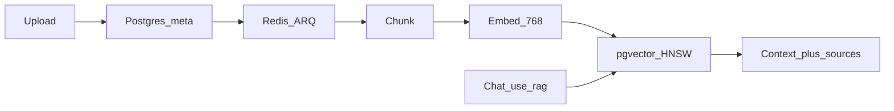

# RAG

**English** · [فارسی](fa/rag.md)

Pipeline:

1. Upload PDF/TXT/MD/DOCX (max 10MB)
2. Chunk (~1800 chars, overlap 200)
3. Embed via PC Worker → LM Studio EmbeddingGemma
4. Store in Postgres `rag_chunks.embedding vector(768)` with HNSW (`vector_cosine_ops`)
5. Chat with `use_rag=true` retrieves top-k sources (over-fetch then filter by user)

Each chunk stores `embed_model_id` and `embed_dim` to prevent silent mixed-model retrieval.

Ingest mode: production `RAG_INGEST_MODE=arq` (run `rag-worker`); tests may use `inline`.

See also: [models.md](models.md), [architecture.md](architecture.md).
