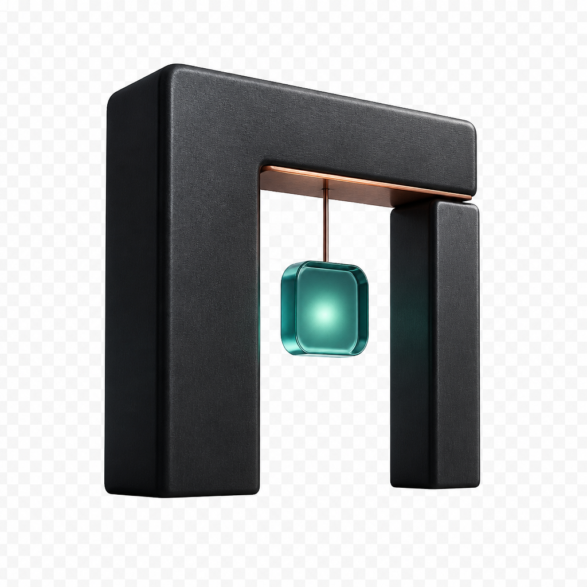
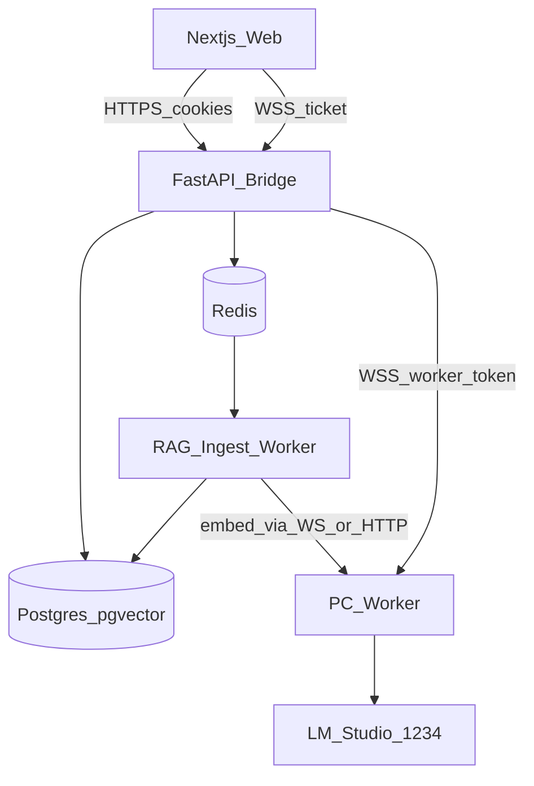
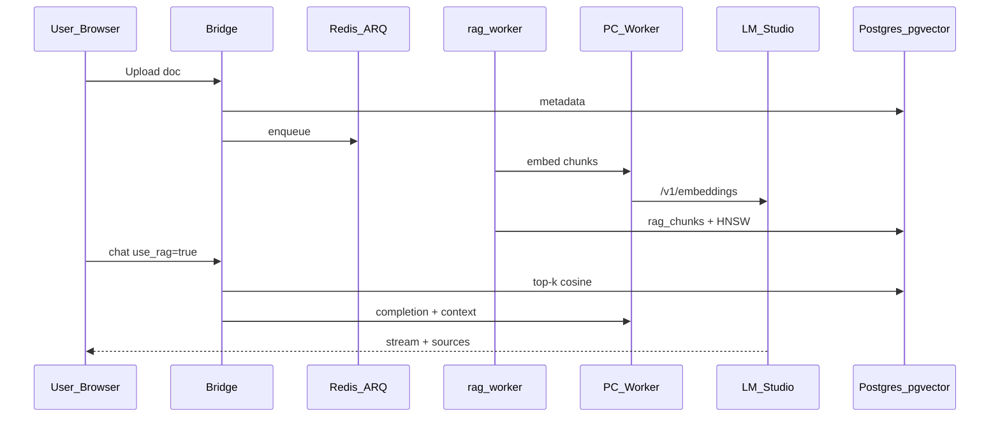

<p align="center">
  
</p>

<h1 align="center">AI Workspace</h1>

<p align="center">

[](https://github.com/Ali-Rashidi-80/lmstudio-Remote-server-client/actions/workflows/ci.yml)
[](VERSION)
[](LICENSE)
[](backend/requirements.txt)
[](web/package.json)

</p>

<p align="center"><a href="readme.md">English</a> · <strong>فارسی</strong></p>

**AI Workspace** یک محصول هوش مصنوعی ریموت چندکاربره است: **پل FastAPI** + وب‌اپ **Next.js (RTL)** + **PostgreSQL/pgvector** + **Redis** + **PC Worker** خانگی/اداری که به **LM Studio** وصل می‌شود — GPU روی ماشین محلی می‌ماند و کاربران از راه دور با چت و دانش خصوصی امن کار می‌کنند.

| | |
|---|---|
| **نسخه** | [`20.0.0`](VERSION) — [`CHANGELOG.md`](CHANGELOG.md) |
| **مجوز** | [MIT](LICENSE) |
| **مستندات** | [`docs/`](docs/) (انگلیسی پیش‌فرض) · [`docs/fa/`](docs/fa/) |
| **زبان پیش‌فرض مخزن** | انگلیسی (`readme.md`). این فایل آینهٔ فارسی است. |

---

## فهرست مطالب

- [چرا این پروژه؟](#چرا-این-پروژه)
- [فاز ۱ شامل چیست](#فاز-۱-شامل-چیست)
- [معماری](#معماری)
- [استک فنی](#استک-فنی)
- [ساختار مخزن](#ساختار-مخزن)
- [پیش‌نیازها](#پیش‌نیازها)
- [شروع سریع](#شروع-سریع)
- [پیکربندی](#پیکربندی)
- [یادداشت‌های عملیاتی](#یادداشت‌های-عملیاتی)
- [استفاده](#استفاده)
- [سطح API](#سطح-api)
- [خط لوله RAG](#خط-لوله-rag)
- [مدل امنیتی](#مدل-امنیتی)
- [میرور ایران / چابکان](#میرور-ایران--چابکان)
- [تست و QA](#تست-و-qa)
- [نقشه مستندات](#نقشه-مستندات)
- [نقشه راه](#نقشه-راه)
- [مشارکت](#مشارکت)
- [عیب‌یابی](#عیب‌یابی)
- [سپاس](#سپاس)
- [مجوز](#مجوز)

---

## چرا این پروژه؟

بیشتر UIهای LLM محلی فرض می‌کنند همه چیز روی یک ماشین است. اینجا مسئله فرق دارد:

- **دسترسی ریموت بدون افشای LM Studio** — مرورگر فقط با Bridge حرف می‌زند؛ اتصال LM Studio فقط نزد Worker است.
- **سطح محصول چندکاربره واقعی** — ثبت‌نام دعوت‌محور، کوکی JWT httpOnly، RBAC، چت سروری، پنل ادمین.
- **دانش خصوصی** — RAG به‌ازای کاربر روی Postgres `pgvector` با EmbeddingGemma (`dim=768`، HNSW cosine).
- **عملیات ایران‌محور** — میرور چابکان برای pip/npm/Docker.
- **پیش‌فرض صادقانه** — بدون تزریق کلید رمزنگاری به HTML؛ قبل از استقرار واقعی همهٔ `change-me-*` را عوض کنید.

تمایز فاز ۱ نسبت به Open WebUI / LibreChat / AnythingLLM: **ریموت امن Bridge↔Worker + امبدینگ محلی + نصب چابکان‌محور** — نه کپی همهٔ فیچرهای سازمانی در یک شات.

---

## فاز ۱ شامل چیست

- احراز هویت دعوت‌محور، کوکی JWT httpOnly، بلیت کوتاه‌عمر WS، RBAC ادمین
- چت سروری، آپلود دانش، RAG با EmbeddingGemma (`dim=768`، HNSW cosine)
- PC Worker با `WORKER_TOKEN` (استریم چت + embeddings)
- API و UI ادمین: آمار / کاربران / دعوت / تنظیمات / reindex / unload
- اسکریپت نصب اولویت میرور چابکان
- Docker Compose: Postgres (pgvector) + Redis + bridge + web

---

## معماری

صفحهٔ داده انتهابه‌انتها (فاز ۱):



### مسیرهای درخواست (خلاصه)

| مسیر | بازیگران | احراز هویت |
|------|----------|------------|
| REST `/api/*` | مرورگر → Bridge | کوکی JWT |
| Client WS `/ws/client` | مرورگر → Bridge | بلیت ۶۰ثانیه‌ای |
| Worker WS `/ws/pc` | PC Worker → Bridge | `WORKER_TOKEN` |
| Embeddings / توکن چت | Worker → LM Studio `:1234` | فقط محلی |

جزئیات: [`docs/fa/architecture.md`](docs/fa/architecture.md) · [English](docs/architecture.md)

---

## استک فنی

| لایه | انتخاب |
|------|--------|
| API | FastAPI (`backend/app/`) |
| وب | Next.js 15، React 19، UI فارسی RTL (`web/`) |
| دیتابیس | PostgreSQL 16 + **pgvector** |
| کش / صف | Redis 7 (rate-limit، readiness، ARQ) |
| بردار | `vector(768)` + HNSW `vector_cosine_ops` |
| مدل چت (پیش‌فرض) | `gemma-4-12b-agentic-fable5-composer2.5-v2-3.5x-tau2@q6_k` |
| امبدینگ (پیش‌فرض) | `text-embedding-embeddinggemma-300m` (`EMBED_DIM=768`) |
| Worker | کلاینت پایتون (`pc_client/`) ↔ API سازگار با OpenAI در LM Studio |
| مهاجرت | Alembic |
| کانتینر | Docker Compose |

---

## ساختار مخزن

```text
.
├── assets/logo.png       # نشان برند
├── docs/assets/logo.png  # لوگو README + logo-prompt.md
├── backend/              # Bridge، Alembic، pytest، ARQ
├── web/                  # UI محصول Next.js (+ public/logo.png)
├── pc_client/            # PC Worker
├── scripts/              # راه‌اندازی، نصب، QA، بکاپ
├── docs/                 # مستندات انگلیسی (پیش‌فرض)
│   └── fa/               # مستندات فارسی
├── archive/legacy/       # آزمایش‌های قدیمی (مسیر محصول نیست)
├── readme.md             # انگلیسی (پیش‌فرض)
└── readme.fa.md          # فارسی
```

`main.py` / `templates/` ریشه و `pc_client/gui_client.py` مسیر محصول نیستند؛ Next.js + `backend/` را ترجیح دهید.

---

## پیش‌نیازها

| ابزار | توضیح |
|-------|--------|
| Python **3.11+** | Bridge، Worker، RAG worker |
| Node.js **20+** | وب Next.js |
| Docker | Postgres + Redis (و اختیاری کل استک) |
| LM Studio | API روی `127.0.0.1:1234` با مدل چت و EmbeddingGemma |
| PowerShell 7+ / bash | اسکریپت‌های `scripts/` |

---

## شروع سریع

1. کپی `.env.example` → `.env` و `pc_client/.env.example` → `pc_client/.env`
2. `docker compose up -d postgres redis` (یا کل استک شامل `bridge` + `rag-worker` + `web`)
3. Bridge: `powershell -File scripts/start-bridge.ps1` (پورت **8010**)
4. RAG worker: `powershell -File scripts/run-rag-worker.ps1`
5. PC Worker: `BRIDGE_WS_URL=ws://127.0.0.1:8010` سپس `cd pc_client && python main.py`
6. وب: `cd web && npm install && npm run dev` (`NEXT_PUBLIC_API_URL=http://localhost:8010`)
7. QA: `powershell -File scripts/qa.ps1` · دود: `python scripts/live_smoke.py`

**اولین ورود:** ادمین bootstrap از `.env` وقتی جدول `users` خالی است.

**نصب ایران:** `powershell -File scripts/install-deps.ps1` یا `bash scripts/install-deps.sh`.

راهنما: [`docs/fa/setup.md`](docs/fa/setup.md) · [English](docs/setup.md)

---

## پیکربندی

| متغیر | کجا | نقش |
|-------|-----|-----|
| `DATABASE_URL` | Bridge | URL اسینک Postgres |
| `REDIS_URL` | Bridge / RAG | Rate-limit، ARQ، readiness |
| `JWT_SECRET` | Bridge | امضای توکن |
| `WORKER_TOKEN` | Bridge + Worker | احراز `/ws/pc` |
| `ADMIN_BOOTSTRAP_*` | Bridge | اولین ادمین فقط اگر جدول خالی باشد |
| `CORS_ORIGINS` | Bridge | مبدأهای مجاز مرورگر |
| `BRIDGE_HOST_PORT` | Compose / میزبان | پورت میزبان (پیش‌فرض **8010**) |
| `RAG_INGEST_MODE` | Bridge | `arq` یا `inline` |
| `EMBED_DIRECT_URL` | Bridge / rag-worker | فقط لابراتوار؛ در prod خالی |
| `COOKIE_SECURE` | Bridge | `true` پشت HTTPS |
| `BRIDGE_WS_URL` | Worker | مثلاً `ws://127.0.0.1:8010` |
| `LMSTUDIO_HOST` | Worker | پیش‌فرض `127.0.0.1:1234` |
| `NEXT_PUBLIC_API_URL` | وب | آدرس Bridge از مرورگر |

قالب‌ها: [`.env.example`](.env.example)، [`pc_client/.env.example`](pc_client/.env.example).

---

## یادداشت‌های عملیاتی

- پورت میزبان Bridge پیش‌فرض **8010** است تا با `:8000` محلی تداخل نکند
- Ingest RAG: **ARQ** با `rag-worker`؛ pytest از `inline` استفاده می‌کند
- در production امبدینگ از Worker؛ `EMBED_DIRECT_URL` فقط برای لاب بدون Worker
- قبل از استقرار واقعی همهٔ `change-me-*` را بچرخانید
- اسکیما: `alembic upgrade head` یا در صورت وجود جداول از قبل `alembic stamp 0001`

استقرار: [`docs/fa/deployment-chabokan.md`](docs/fa/deployment-chabokan.md) · بکاپ: `scripts/backup-postgres.sh`

---

## استفاده

### وب

1. `http://localhost:3000`
2. ورود ادمین یا پذیرش دعوت در `/accept-invite`
3. **چت** — استریم؛ در صورت نیاز RAG را روشن کنید
4. **دانش** — آپلود PDF/TXT/MD/DOCX (حداکثر **۱۰MB**)
5. **ادمین** — کاربران، دعوت، آمار، تنظیمات، reindex، unload

### Worker

LM Studio را با مدل‌های پیکربندی‌شده روشن نگه دارید. `WORKER_TOKEN` باید با Bridge یکی باشد؛ در production از `wss://` استفاده کنید.

### سلامت

```bash
curl -s http://127.0.0.1:8010/api/health
curl -s http://127.0.0.1:8010/api/ready
```

---

## سطح API

| متد | مسیر | Auth | یادداشت |
|-----|------|------|---------|
| GET | `/api/health` | خیر | زنده‌بودن |
| GET | `/api/ready` | خیر | DB + Redis + worker |
| POST | `/api/auth/login` | خیر | کوکی httpOnly |
| POST | `/api/auth/ws-ticket` | کاربر | بلیت ۶۰ثانیه |
| POST | `/api/auth/accept-invite` | خیر | ثبت‌نام دعوت‌محور |
| POST | `/api/auth/register` | — | همیشه **403** |
| GET/POST | `/api/chats` | کاربر | مالکیت اجباری |
| GET/POST/DELETE | `/api/knowledge/docs` | کاربر | اسناد RAG |
| GET | `/api/admin/stats` | ادمین | داشبورد |

پروتکل WS `v:1` — جزئیات کامل: [`docs/fa/api.md`](docs/fa/api.md)

---

## خط لوله RAG



جزئیات: [`docs/fa/rag.md`](docs/fa/rag.md) · [`docs/fa/models.md`](docs/fa/models.md)

---

## مدل امنیتی

- TLS/WSS + کاربر احرازشده و توکن Worker
- بدون تزریق کلید مشترک به HTML
- ثبت‌نام فقط با دعوت؛ `/api/auth/register` غیرفعال
- ردیف‌های چت و RAG با `user_id`
- `unload_models` فقط ادمین
- محدودیت نرخ ورود با Redis

[`SECURITY.fa.md`](SECURITY.fa.md) · [`docs/fa/security.md`](docs/fa/security.md)

---

## میرور ایران / چابکان

| اکوسیستم | میرور |
|----------|--------|
| PyPI | `https://mirror2.chabokan.net/pypi/simple/` |
| npm | `https://mirror2.chabokan.net/npm/` |
| Docker | میرور daemon یا پیشوند `mirror2.chabokan.net/...` |

[`docs/fa/mirrors-iran.md`](docs/fa/mirrors-iran.md) · منبع: [iran.chabokan.net](https://iran.chabokan.net/)

---

## تست و QA

```powershell
powershell -File scripts/qa.ps1
```

CI: lint/types/tests روی Postgres+pgvector و Redis + gitleaks. دود زنده: `python scripts/live_smoke.py`.

---

## نقشه مستندات

جدول کامل در [`readme.md`](readme.md#documentation-map) و [`docs/fa/README.md`](docs/fa/README.md).

---

## نقشه راه

**فاز ۱ (موجود):** auth/RBAC چندکاربره، چت سروری، RAG pgvector، Worker، ادمین، Compose، اسکریپت چابکان، CI.

**فاز ۲ (برنامه):** SSO/LDAP، MCP/ایجنت غنی‌تر، جستجوی وب چندپروایدر، متریک، voice/arena.

---

## مشارکت

[`CONTRIBUTING.fa.md`](CONTRIBUTING.fa.md) · [English](CONTRIBUTING.md)

---

## عیب‌یابی

| علامت | رفع محتمل |
|-------|-----------|
| تداخل پورت Bridge | میزبان **8010** |
| `/api/ready` آماده نیست | Postgres + Redis + Worker و `WORKER_TOKEN` |
| RAG تمام نمی‌شود | `rag-worker` با `RAG_INGEST_MODE=arq` |
| CORS / کوکی | هم‌ترازی `CORS_ORIGINS` و `COOKIE_SECURE` |
| عدم تطابق dim امبد | reindex پس از تعویض مدل |

[`docs/fa/troubleshooting.md`](docs/fa/troubleshooting.md)

---

## سپاس

LM Studio، pgvector، FastAPI، Next.js، ARQ، چابکان — و راهنماهای ساختار README حرفه‌ای (banger-readme / OSS_SPEC / تحقیقات ۲۰۲۴–۲۰۲۶).

---

## مجوز

[MIT](LICENSE) © ۲۰۲۶ مشارکت‌کنندگان AI Workspace

مستندات: [`docs/`](docs/) · مجوز: MIT · نسخه: [`VERSION`](VERSION)
