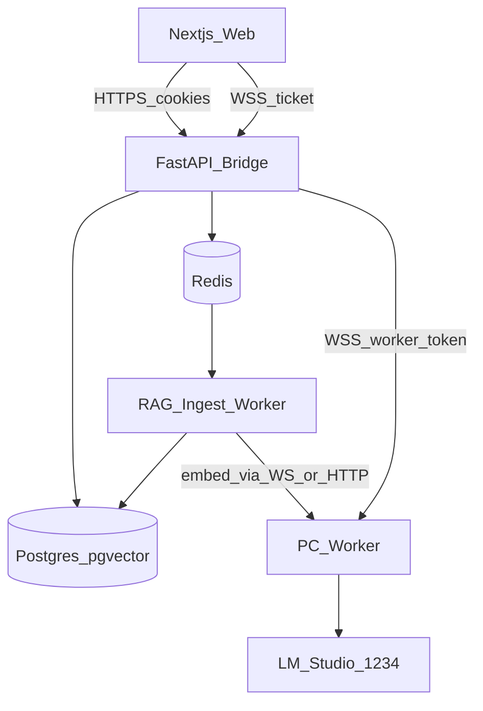
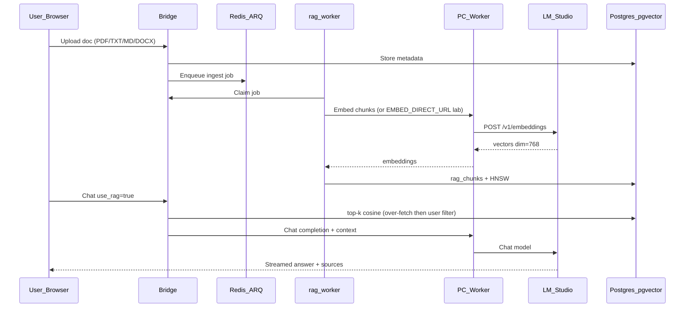

# AI Workspace

[](https://github.com/Ali-Rashidi-80/lmstudio-Remote-server-client/actions/workflows/ci.yml)
[](VERSION)
[](LICENSE)
[](backend/requirements.txt)
[](web/package.json)

**English** · [فارسی](readme.fa.md)

**AI Workspace** is a multi-user remote AI product: a **FastAPI Bridge** + **Next.js (RTL)** web app + **PostgreSQL/pgvector** + **Redis** + a home/office **PC Worker** that talks to **LM Studio** — so your GPU stays local while users chat and search private knowledge securely over the network.

| | |
|---|---|
| **Version** | [`20.0.0`](VERSION) — see [`CHANGELOG.md`](CHANGELOG.md) |
| **License** | [MIT](LICENSE) |
| **Docs** | [`docs/`](docs/) · [فارسی](docs/fa/) |
| **Default language** | English (this file). Persian mirrors live next to English sources. |

---

## Table of contents

- [Why](#why)
- [What phase 1 includes](#what-phase-1-includes)
- [Architecture](#architecture)
- [Tech stack](#tech-stack)
- [Repository layout](#repository-layout)
- [Prerequisites](#prerequisites)
- [Quick start](#quick-start)
- [Configuration](#configuration)
- [Ops notes](#ops-notes)
- [Usage](#usage)
- [API surface](#api-surface)
- [RAG pipeline](#rag-pipeline)
- [Security model](#security-model)
- [Iran / Chabokan mirrors](#iran--chabokan-mirrors)
- [Testing & QA](#testing--qa)
- [Documentation map](#documentation-map)
- [Roadmap](#roadmap)
- [Contributing](#contributing)
- [Troubleshooting](#troubleshooting)
- [Acknowledgements](#acknowledgements)
- [License](#license)

---

## Why

Typical local LLM UIs assume everything runs on one machine. This project targets a different problem:

- **Remote access without exposing LM Studio** — browsers talk to the Bridge; only the PC Worker holds the LM Studio connection.
- **Real multi-user product surface** — invite-only auth, JWT httpOnly cookies, RBAC, server-side chats, admin UI.
- **Private knowledge** — per-user RAG on Postgres `pgvector` with EmbeddingGemma (`dim=768`, HNSW cosine), not a shared anonymous dump.
- **Iran-first ops** — Chabokan mirrors for pip/npm/Docker when international registries are painful.
- **Honest defaults** — no encryption keys injected into HTML; rotate every `change-me-*` secret before real deploy.

Compared with Open WebUI / LibreChat / AnythingLLM-style stacks, phase 1 differentiates on **secure Bridge↔Worker remote GPU + local embeddings + Chabokan-oriented install**, not on cloning every enterprise feature in one shot.

---

## What phase 1 includes

- Invite-only auth, JWT httpOnly cookies, short-lived WS tickets, admin RBAC
- Server-side chats, knowledge upload, RAG with EmbeddingGemma (`dim=768`, HNSW cosine)
- PC Worker authenticated with `WORKER_TOKEN` (chat stream + embeddings)
- Admin stats/users/invites/settings/reindex/unload APIs + admin UI
- Chabokan-first install scripts for Iran mirrors
- Docker Compose: Postgres (pgvector) + Redis + bridge + web

---

## Architecture

End-to-end data plane (phase 1):



### Request paths (summary)

| Path | Actors | Auth |
|------|--------|------|
| REST `/api/*` | Browser → Bridge | JWT cookies (`access_token` / `refresh_token`) |
| Client WS `/ws/client` | Browser → Bridge | 60s ticket from `POST /api/auth/ws-ticket` |
| Worker WS `/ws/pc` | PC Worker → Bridge | `WORKER_TOKEN` query/header token |
| Embeddings / chat tokens | Worker → LM Studio `:1234` | Local only (never from browser) |

More detail: [`docs/architecture.md`](docs/architecture.md) · [فارسی](docs/fa/architecture.md)

---

## Tech stack

| Layer | Choice |
|-------|--------|
| API | FastAPI (`backend/app/`) |
| Web | Next.js 15 App Router, React 19, Persian RTL UI (`web/`) |
| DB | PostgreSQL 16 + **pgvector** |
| Cache / queue | Redis 7 (rate-limit, readiness, ARQ RAG ingest) |
| Vectors | `vector(768)` + HNSW `vector_cosine_ops` |
| Chat model (default) | `gemma-4-12b-agentic-fable5-composer2.5-v2-3.5x-tau2@q6_k` |
| Embedding (default) | `text-embedding-embeddinggemma-300m` (`EMBED_DIM=768`) |
| Worker | Python PC client (`pc_client/`) ↔ LM Studio OpenAI-compatible API |
| Migrations | Alembic |
| Containers | Docker Compose (`postgres`, `redis`, `bridge`, `rag-worker`, `web`) |

---

## Repository layout

```text
.
├── backend/                 # FastAPI Bridge, Alembic, pytest, ARQ worker
├── web/                     # Next.js product UI (login, chat, knowledge, admin)
├── pc_client/               # PC Worker (LM Studio relay)
├── scripts/                 # start-bridge, rag-worker, install-deps, qa, backup
├── docs/                    # English docs (default)
│   └── fa/                  # Persian docs
├── archive/legacy/          # Old single-key / mobile experiments (not product path)
├── docker-compose.yml
├── .env.example             # Bridge env template (no real secrets)
├── CHANGELOG.md
├── LICENSE
├── VERSION
├── readme.md                # English (default)
└── readme.fa.md             # فارسی
```

Legacy root `main.py` / `templates/` and `pc_client/gui_client.py` are **not** the product UI. Prefer Next.js + `backend/`.

---

## Prerequisites

| Tool | Notes |
|------|--------|
| Python **3.11+** | Bridge, Worker, RAG worker |
| Node.js **20+** | Next.js web |
| Docker | Postgres + Redis (and optional full stack) |
| LM Studio | API on `127.0.0.1:1234` with chat + EmbeddingGemma loaded |
| PowerShell 7+ / bash | Scripts under `scripts/` |

---

## Quick start

1. Copy `.env.example` → `.env` and `pc_client/.env.example` → `pc_client/.env`
2. `docker compose up -d postgres redis` (or full stack including `bridge` + `rag-worker` + `web`)
3. Bridge: `powershell -File scripts/start-bridge.ps1` (port **8010**)
4. RAG worker: `powershell -File scripts/run-rag-worker.ps1`
5. PC Worker: set `BRIDGE_WS_URL=ws://127.0.0.1:8010` then `cd pc_client && python main.py`
6. Web: `cd web && npm install && npm run dev` (`NEXT_PUBLIC_API_URL=http://localhost:8010`)
7. QA: `powershell -File scripts/qa.ps1` · smoke: `python scripts/live_smoke.py`

**First login:** bootstrap admin from `.env` (`ADMIN_BOOTSTRAP_USERNAME` / `ADMIN_BOOTSTRAP_PASSWORD`, password ≥ 10 chars) when the `users` table is empty.

**Iran install helpers:** `powershell -File scripts/install-deps.ps1` or `bash scripts/install-deps.sh` (Chabokan mirrors first).

Full walkthrough: [`docs/setup.md`](docs/setup.md) · [فارسی](docs/fa/setup.md)

---

## Configuration

| Variable | Where | Purpose |
|----------|--------|---------|
| `DATABASE_URL` | Bridge | Postgres async URL (`postgresql+asyncpg://…`) |
| `REDIS_URL` | Bridge / RAG worker | Rate-limit, ARQ, readiness |
| `JWT_SECRET` | Bridge | Sign access/refresh tokens |
| `WORKER_TOKEN` | Bridge + Worker | Authenticate `/ws/pc` |
| `ADMIN_BOOTSTRAP_*` | Bridge | First admin only if users table empty |
| `CORS_ORIGINS` | Bridge | Allowed browser origins (comma-separated) |
| `BRIDGE_HOST_PORT` | Compose / host | Host publish port (default **8010**) |
| `RAG_INGEST_MODE` | Bridge | `arq` (prod) or `inline` (pytest/lab) |
| `EMBED_DIRECT_URL` | Bridge / rag-worker | Lab-only direct LM Studio embeddings; **empty in prod** |
| `COOKIE_SECURE` | Bridge | `true` behind HTTPS |
| `BRIDGE_WS_URL` | Worker | e.g. `ws://127.0.0.1:8010` or `wss://…` |
| `LMSTUDIO_HOST` | Worker | Default `127.0.0.1:1234` |
| `NEXT_PUBLIC_API_URL` | Web | Browser → Bridge base URL |

Templates: [`.env.example`](.env.example), [`pc_client/.env.example`](pc_client/.env.example).

---

## Ops notes

- Host Bridge port defaults to **8010** (`BRIDGE_HOST_PORT`) so it does not collide with other local apps on `:8000`
- RAG ingest: **ARQ** via `rag-worker` (`RAG_INGEST_MODE=arq`); pytest uses `inline`
- Prefer Worker for embeddings in production; set `EMBED_DIRECT_URL` only for local lab without Worker
- Rotate all `change-me-*` secrets before any real deployment
- Schema: `alembic upgrade head` (fresh DB) or `alembic stamp 0001` if tables already exist from `create_all`

Deploy sketch (Chabokan / VPS): [`docs/deployment-chabokan.md`](docs/deployment-chabokan.md) · [فارسی](docs/fa/deployment-chabokan.md)

Backup: `scripts/backup-postgres.sh` (schedule `pg_dump` in production).

---

## Usage

### Web (happy path)

1. Open `http://localhost:3000`
2. Log in as bootstrap admin (or accept an invite at `/accept-invite`)
3. **Chat** — stream replies; enable RAG when you need document sources
4. **Knowledge** — upload PDF / TXT / MD / DOCX (max **10 MB**); wait for ingest job
5. **Admin** — users, invites, stats, settings, reindex, unload models

### Worker

Keep LM Studio running with the configured chat + embedding models. The Worker must share the same `WORKER_TOKEN` as the Bridge and point `BRIDGE_WS_URL` at the Bridge (use `wss://` in production).

### Minimal health checks

```bash
curl -s http://127.0.0.1:8010/api/health
curl -s http://127.0.0.1:8010/api/ready
```

`/api/ready` reflects DB + Redis + worker presence.

---

## API surface

High-level REST (auth noted):

| Method | Path | Auth | Notes |
|--------|------|------|-------|
| GET | `/api/health` | no | Liveness |
| GET | `/api/ready` | no | DB + Redis + worker |
| POST | `/api/auth/login` | no | Sets httpOnly cookies |
| POST | `/api/auth/ws-ticket` | user | 60s WS ticket |
| POST | `/api/auth/accept-invite` | no | Invite-only signup |
| POST | `/api/auth/register` | — | Always **403** |
| GET/POST | `/api/chats` | user | Ownership enforced |
| GET/POST/DELETE | `/api/knowledge/docs` | user | RAG documents |
| GET | `/api/admin/stats` | admin | Admin dashboard |

**WebSocket protocol `v:1`**

- Client: `WS /ws/client?ticket=...`
- Worker: `WS /ws/pc?token=WORKER_TOKEN`

```json
{ "v": 1, "type": "chat", "payload": { "content": "...", "chat_id": "...", "use_rag": true } }
```

Full tables & envelopes: [`docs/api.md`](docs/api.md) · [فارسی](docs/fa/api.md)

---

## RAG pipeline



- Chunk ~1800 chars, overlap 200
- Each chunk stores `embed_model_id` + `embed_dim` (no silent mixed-model retrieval)
- Changing the embedding model requires a **full reindex**

Details: [`docs/rag.md`](docs/rag.md) · [`docs/models.md`](docs/models.md) · Persian: [`docs/fa/rag.md`](docs/fa/rag.md), [`docs/fa/models.md`](docs/fa/models.md)

---

## Security model

- TLS/WSS + authenticated users (cookies) and worker token
- No shared encryption key injected into HTML
- Invite-only registration; open `/api/auth/register` disabled
- Chat and RAG rows scoped by `user_id`
- `unload_models` is admin-only
- Login rate-limited via Redis
- Cookies: `HttpOnly`, `SameSite=Lax`, `Secure` when `COOKIE_SECURE=true`
- Worker: `TLS_VERIFY=true` in production

Policy & hygiene: [`SECURITY.md`](SECURITY.md) · [`docs/security.md`](docs/security.md) · [فارسی](docs/fa/security.md)

---

## Iran / Chabokan mirrors

Prefer local mirrors when international connectivity is restricted:

| Ecosystem | Mirror |
|-----------|--------|
| PyPI | `https://mirror2.chabokan.net/pypi/simple/` |
| npm | `https://mirror2.chabokan.net/npm/` (`web/.npmrc`) |
| Docker | daemon mirror or `mirror2.chabokan.net/...` prefix |

Scripts fall back to upstream automatically. Guide: [`docs/mirrors-iran.md`](docs/mirrors-iran.md) · [فارسی](docs/fa/mirrors-iran.md) · source [iran.chabokan.net](https://iran.chabokan.net/)

---

## Testing & QA

```powershell
powershell -File scripts/qa.ps1
# or from backend/
cd backend
ruff check app tests
black --check app tests
isort --check-only app tests
flake8 app tests --max-line-length=100 --extend-ignore=E501,E203,E402
mypy app --ignore-missing-imports
pytest -q
```

CI (GitHub Actions): backend lint/types/tests against Postgres+pgvector + Redis, plus gitleaks. Live smoke (needs running stack): `python scripts/live_smoke.py`.

---

## Documentation map

| Doc | English | فارسی |
|-----|---------|--------|
| Docs home | [`docs/README.md`](docs/README.md) | [`docs/fa/README.md`](docs/fa/README.md) |
| Setup | [`docs/setup.md`](docs/setup.md) | [`docs/fa/setup.md`](docs/fa/setup.md) |
| Architecture | [`docs/architecture.md`](docs/architecture.md) | [`docs/fa/architecture.md`](docs/fa/architecture.md) |
| API | [`docs/api.md`](docs/api.md) | [`docs/fa/api.md`](docs/fa/api.md) |
| RAG | [`docs/rag.md`](docs/rag.md) | [`docs/fa/rag.md`](docs/fa/rag.md) |
| Models | [`docs/models.md`](docs/models.md) | [`docs/fa/models.md`](docs/fa/models.md) |
| Security | [`docs/security.md`](docs/security.md) | [`docs/fa/security.md`](docs/fa/security.md) |
| Troubleshooting | [`docs/troubleshooting.md`](docs/troubleshooting.md) | [`docs/fa/troubleshooting.md`](docs/fa/troubleshooting.md) |
| Chabokan deploy | [`docs/deployment-chabokan.md`](docs/deployment-chabokan.md) | [`docs/fa/deployment-chabokan.md`](docs/fa/deployment-chabokan.md) |
| Iran mirrors | [`docs/mirrors-iran.md`](docs/mirrors-iran.md) | [`docs/fa/mirrors-iran.md`](docs/fa/mirrors-iran.md) |
| Contributing | [`CONTRIBUTING.md`](CONTRIBUTING.md) | [`CONTRIBUTING.fa.md`](CONTRIBUTING.fa.md) |
| Security policy | [`SECURITY.md`](SECURITY.md) | [`SECURITY.fa.md`](SECURITY.fa.md) |
| Changelog | [`CHANGELOG.md`](CHANGELOG.md) | — |

---

## Roadmap

**Phase 1 (shipped):** multi-user auth/RBAC, server chats, pgvector RAG, Worker relay, admin, Compose, Chabokan scripts, CI.

**Phase 2 (planned):** SSO/LDAP, richer agent/MCP flows, multi-provider web search, stronger observability (metrics), voice/arena-style UX.

---

## Contributing

See [`CONTRIBUTING.md`](CONTRIBUTING.md) · [فارسی](CONTRIBUTING.fa.md). Short version: branch from `main`, keep secrets out of git, run `scripts/qa.ps1` before PR, prefer English for code/comments and dual-language for user-facing docs.

---

## Troubleshooting

| Symptom | Likely fix |
|---------|------------|
| Bridge port clash | Use host **8010** (`BRIDGE_HOST_PORT` / `scripts/start-bridge.ps1`) |
| `/api/ready` not ready | Start Postgres, Redis, and PC Worker; check `WORKER_TOKEN` |
| RAG never finishes | Run `rag-worker` with `RAG_INGEST_MODE=arq`; verify embeddings path |
| CORS / cookie issues | Align `CORS_ORIGINS` with the web origin; set `COOKIE_SECURE` correctly |
| Embed dim mismatch | Reindex after model change; keep `EMBED_DIM=768` for EmbeddingGemma |

Full playbook: [`docs/troubleshooting.md`](docs/troubleshooting.md) · [فارسی](docs/fa/troubleshooting.md)

---

## Acknowledgements

- [LM Studio](https://lmstudio.ai/) — local model runtime
- [pgvector](https://github.com/pgvector/pgvector) — Postgres vectors
- [FastAPI](https://fastapi.tiangolo.com/), [Next.js](https://nextjs.org/), [ARQ](https://github.com/python-arq/arq)
- [Chabokan](https://iran.chabokan.net/) — Iran package/container mirrors
- README craft influenced by [anatomy-of-a-readme](https://github.com/kerryhatcher/banger-readme/blob/main/docs/anatomy-of-a-readme.md), [OSS_SPEC](https://github.com/niclaslindstedt/oss-spec), and open-source README research (2024–2026)

---

## License

[MIT](LICENSE) © 2026 AI Workspace contributors

Docs: [`docs/`](docs/) · License: MIT · Version: see [`VERSION`](VERSION)
